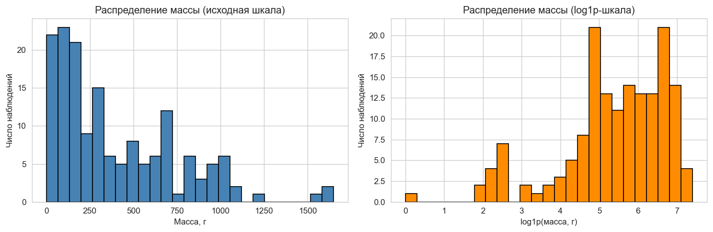
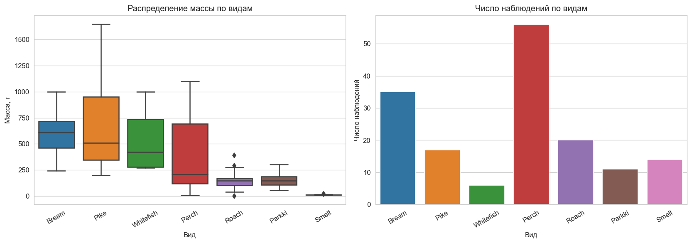
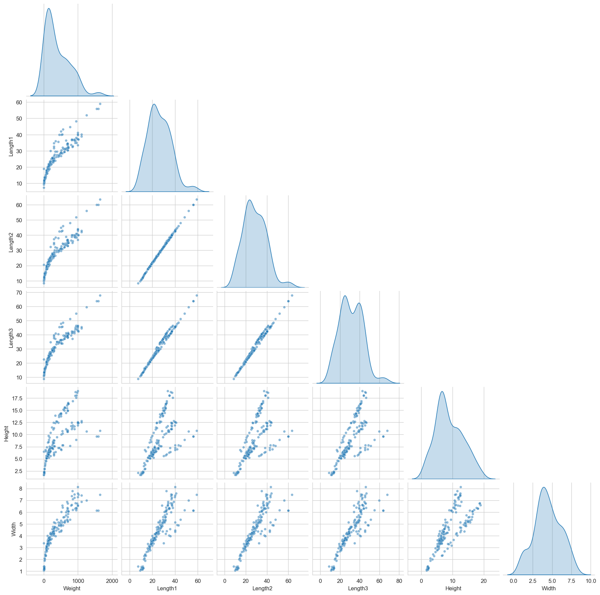
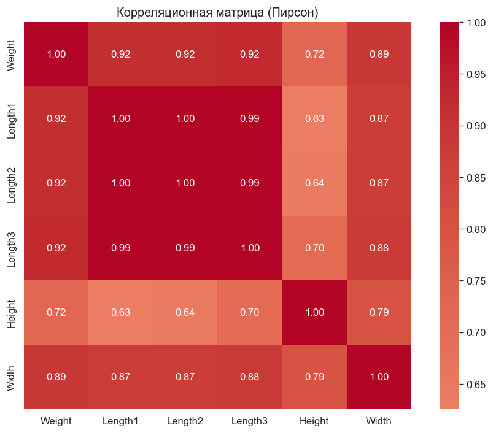
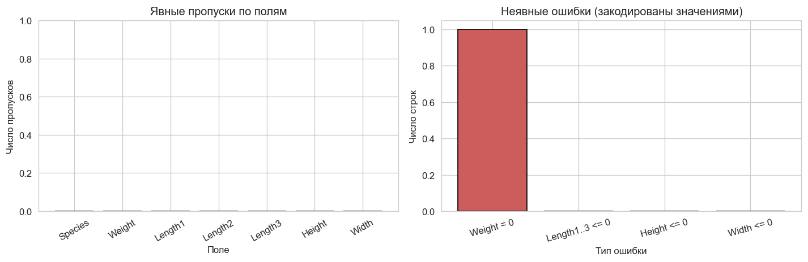
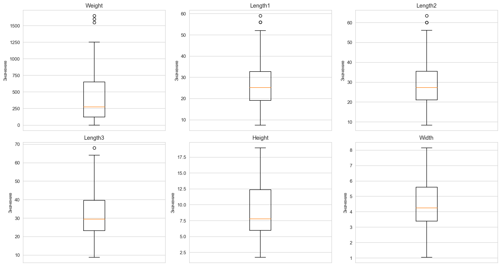
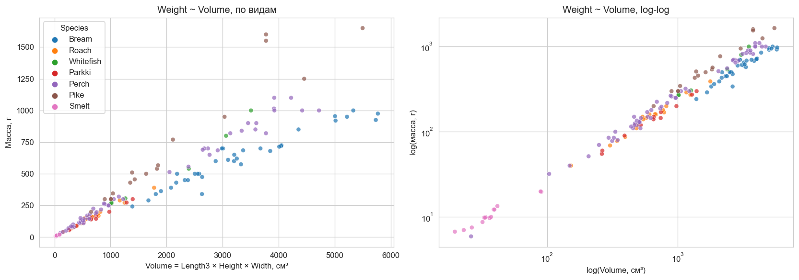

Лабораторная работа №1. Платформа FishGrow: исследовательский анализ данных

Дисциплина: Введение в искусственный интеллект
Студент:Осипов Владислав Алексеевич
Группа: 22206
Дата: 12.10.26
Ветка: `lab/01-eda`
Исходный коммит: `1f65547` (Tyler Russin, Update README.md, 25.02.2022)
Источник данных: датасет Aung Pyae (Fish Market), Kaggle. Оригинальный репозиторий: `tylerrussin/Fish-Dimensions-Regression-Analysis`.

1. Воспроизведение исходного состояния

Репозиторий склонирован, зафиксирован коммит `1f65547`. Ветка `lab/01-eda` создана.

Окружение: Python 3.7.9, виртуальное окружение Pipenv (`Fish-Dimensions-Regression-Analysis-fi_HH1th`). Установлены зависимости из `Pipfile.lock`.

Ключевые версии: dash 2.1.0, pandas 1.3.5, numpy 1.21.5, plotly 5.6.0, statsmodels 0.13.2, scipy 1.7.3. Дополнительно установлены: jupyter, matplotlib 3.5.3, seaborn 0.12.2, scikit-learn (все в `[dev-packages]`).

Запуск: `pipenv run python run.py`. Приложение доступно на `http://127.0.0.1:8050/`. Обе страницы (главная и `predictions`) открываются. Ошибок при запуске нет.

Расхождение с инструкцией: датасет в исходном репозитории лежит в `assets/data/Fish.csv`, а не в `data/fish.csv`. Создан каталог `data/` и скопирован файл для соответствия каркасу задания.

2. Паспорт данных

| Поле     | Смысл               | Тип   | Единицы    | Назначение           | Пропуски       | Диапазон (факт) |
|---       |---                  |---    |---         |---                   |---             |---              |
| Species  | Вид рыбы            | str   | —          | группирующий признак | недопустимы, 0 | 7 категорий     |
| Weight   | Масса               | float | граммы (г) | целевая переменная   | недопустимы, 0 | 0–1650          |
| Length1  | Вертикальная длина  | float | см         | признак              | недопустимы, 0 | 7.5–59.0        |
| Length2  | Диагональная длина  | float | см         | признак              | недопустимы, 0 | 8.4–63.4        |
| Length3  | Поперечная длина    | float | см         | признак              | недопустимы, 0 | 8.8–68.0        |
| Height   | Высота              | float | см         | признак              | недопустимы, 0 | 1.73–18.96      |
| Width    | Диагональная ширина | float | см         | признак              | недопустимы, 0 | 1.05–8.14       |

Единица наблюдения: одна рыба.

Риски данных. В README исходного репозитория указан тип `int` для числовых признаков, фактически все они `float64`. README называет пять «length measurements», хотя длин три (`Length1`, `Length2`, `Length3`) плюс `Height` и `Width`. Названия в интерфейсе (`pages/predictions.py`) не совпадают с определениями в README: `Width` назван «Diagonal width» в README и просто «Width» в UI; `Length3` — «Cross length» и «Length» соответственно. Единицы (см, г) подтверждены README и слайдерами UI.

3. Качество данных

Явных пропусков нет ни в одном поле. Дубликатов строк нет. Дубликатов по всем числовым полям — нет.

Проверки физического смысла:

| Проверка                      | Нарушений |
|---                            |---        |
| Weight > 0                    | 1         |
| Length1 > 0                   | 0         |
| Length2 > 0                   | 0         |
| Length3 > 0                   | 0         |
| Height > 0                    | 0         |
| Width > 0                     | 0         |
| Length1 <= Length2            | 0         |
| Length2 <= Length3            | 0         |
| Species в известном множестве | 0         |

Единственная аномалия — строка с индексом 40, вид Roach, `Weight = 0`. Длины и ширина в норме (Length3 = 22.8, медиана Roach = 25.0). Это MNAR-подобная ошибка: значение отсутствует, но закодировано невозможным числом.

4. Визуализация

4.1 Распределение массы

Вывод. Масса имеет сильную правостороннюю асимметрию (пик 0–250 г, хвост до 1650 г). Нулевое значение — не часть распределения, а закодированный пропуск. В log1p-шкале распределение приближается к симметричному, что снижает влияние выбросов и улучшает условия для линейных моделей.

4.2 Масса по видам

Вывод. Масса значимо различается по видам: Smelt и Roach — самые лёгкие (медианы ~50 и ~150 г), Whitefish и Bream — самые тяжёлые (медианы ~600 г). Наибольший разброс у Pike (от 200 до 1650 г). Численность видов различается почти в 10 раз (Perch 56 против Whitefish 6) — требуется стратифицированное разбиение и осторожность при оценке метрик по малым группам.

4.3 Матрица парных графиков

Вывод. Три признака длины (Length1, Length2, Length3) попарно почти линейно зависимы — это три вложенных измерения одного объекта, что создаёт мультиколлинеарность. Связь массы с длинами нелинейная (выпуклая, ближе к степенной W ~ L^3), поэтому одних длин в линейной регрессии недостаточно; логарифмирование или объёмный признак предпочтительнее. Height и Width слабее связаны с массой и имеют отдельные структуры (двугорбость Height).

4.4 Корреляционная матрица

Вывод. Корреляция Пирсона между тремя длинами 0.99–1.00 — они дублируют друг друга, включать все три в модель нельзя. С массой сильнее всего связаны Length3 (0.92), Length2 (0.92), Length1 (0.92) — практически одинаково. Width 0.89, Height 0.72. Пирсон измеряет только линейную связь; на pairplot связь массы с длинами выпуклая, поэтому реальная объяснительная сила признаков выше, чем r. Удалять признак автоматически по порогу 0.9 нельзя.

4.5 Пропуски и маскированные ошибки

Вывод. Явных пропусков нет. Единственная ошибка данных — масса, закодированная нулём (строка 40, Roach). Это MNAR-подобный случай. Явные пропуски и неявные ошибки требуют разных решений: первые можно обрабатывать типовыми методами, вторые сначала нужно обнаружить через проверку физического смысла.

4.6 Выбросы

Вывод. По IQR-критерию подозрительны 3 строки по массе, 3 по Length1, 3 по Length2, 1 по Length3; по Height и Width — ноль. Все «выбросы» — крупные экземпляры Pike и Perch с массой 1000–1650 г и длиной 42–68 см (индексы 121, 123, 125, 141, 142, 143, 144). Это не ошибки измерения, а реальные наблюдения, наиболее ценные для проверки обобщающей способности модели. Автоматическое удаление таких строк лишит модель информации о крайних значениях.

4.7 Сравнение IQR и MAD

| Признак | IQR-выбросов | MAD-выбросов | Пересечение | Только IQR    | Только MAD |
|---      |---           |---           |---          |---            |---         |
| Weight  | 3            | 3            | 3           | —             | —          |
| Length1 | 3            | 0            | 0           | 142, 143, 144 | —          |
| Length2 | 3            | 0            | 0           | 142, 143, 144 | —          |
| Length3 | 1            | 0            | 0           | 144           | —          |
| Height  | 0            | 0            | 0           | —             | —          |
| Width   | 0            | 0            | 0           | —             | —          |

Вывод. IQR и MAD согласны только по массе (3 общих выброса). По длинам IQR отмечает строки 142–144, MAD — ни одной. Причина: у длин плотное ядро и тяжёлый хвост, MAD на медиане консервативнее IQR на квартилях. Расхождение методов — аргумент против автоматического удаления. Критерий выброса не равен критерию ошибки.

4.8 Проверка гипотезы 1 (физическая)

Вывод. Корреляция Weight ~ Volume в целом по таблице 0.932, чуть выше одиночной Length3 (0.923). Однако внутри видов корреляция радикально выше: от 0.945 (Roach) до 0.996 (Parkki). Разрыв между общей и внутривидовой корреляцией — эффект смешения: разные виды имеют разную плотность и форму тела, поэтому при одинаковом объёме масса отличается. Volume полезен, но сильнее всего работает в комбинации со Species.

На log-log шкале точки выстраиваются в прямую линию с малым разбросом, что подтверждает степенную зависимость W ~ V^α.

5. Гипотезы

5.1 Гипотеза 1: объём как предиктор массы

Формулировка. Объём, приближённо вычисленный как `V = Length3 × Height × Width`, объясняет большую часть дисперсии массы.

Проверка. Корреляция Weight ~ Volume = 0.932 по всей таблице, 0.945–0.996 внутри видов. В log-log-шкале наблюдается линейная зависимость.

Результат. Гипотеза подтверждается. Целевая переменная при вычислении V не использовалась — утечки нет.

5.2 Гипотеза 2: вид как независимый фактор

Формулировка. Вид рыбы добавляет объяснительную силу сверх геометрии.

Проверка. Сравнение двух OLS-моделей на данных без нулевой массы (158 наблюдений):

| Модель                         | R²      | Adj R² |
|---                             |---      |---     |
| `Weight ~ Volume`              | 0.8691  | 0.8683 |
| `Weight ~ Volume + C(Species)` | 0.9468  | 0.9443 |

ANOVA: F = 36.47, p = 5.2e-27.

Результат. Гипотеза подтверждается. Вклад Species высокозначим. Модель с двумя признаками (Adj R² 0.944) не намного уступает модели автора из шести признаков (Adj R² 0.960), что говорит о сильной избыточности трёх длин.

5.3 Проверка влияния строки 40

Одна строка с массой 0 снижает внутривидовую корреляцию Roach с 0.9907 до 0.9451. На общую корреляцию по таблице почти не влияет (0.9323 против 0.9324). Типичный эффект MNAR-ошибки в малочисленной группе.

6. Разбиение и проверка утечек

Правило разбиения. Единица наблюдения — отдельная рыба. Групп (партий, ферм, моментов времени) в данных нет, поэтому используется стратификация по `Species`, а не group split. Строка с `Weight = 0` исключается до разбиения. Пропорции 60/20/20, `stratify=Species`, `random_state=42`.

Результат:

| Выборка | Размер | Perch | Bream | Roach | Pike | Smelt | Parkki | Whitefish |
|---      |---     |---    |---    |---    |---   |---    |---     |---        |
| train   | 94     | 33    | 21    | 11    | 10   | 8     | 7      | 4         |
| val     | 32     | 12    | 7     | 4     | 3    | 3     | 2      | 1         |
| test    | 32     | 11    | 7     | 4     | 4    | 3     | 2      | 1         |

Стратификация сохраняет пропорции всех видов, включая малочисленные.

Каналы утечки:

| # | Канал                   | Где может возникнуть                                                           | Меры |
|---|---                      |---                                                                             |---   |
| 1 | Статистики всей таблицы | Стандартизация, импутация, подбор гиперпараметров по всей таблице до разбиения | Считать статистики только на train, применять к val/test |
| 2 | Повторные строки | Одна и та же рыба занесена дважды; при случайном разбиении попадёт в train и test | Проверка дубликатов до разбиения (в данных — 0) |
| 3 | Идентификатор | Использование индекса строки как признака | Индекс не подавать в модель; id в датасете нет |
| 4 | Постфактум измерение | Случайное измерение, доступное только после взвешивания | Признак Volume вычисляется только из L/H/W, целевая переменная не используется |
| 5 | Ручной подбор по тесту | Итеративная подгонка модели и признаков с оглядкой на test | Test трогаем один раз в конце; вся настройка — на val |

7. Итоговые решения

1. Строка 40 (Roach, Weight = 0) исключена из обучения на массе. В EDA оставлена для иллюстрации MNAR-ошибки.
2. Из трёх длин для моделирования достаточно одной (Length3), так как все три коррелируют 0.99+. Окончательный выбор — за этапом моделирования.
3. Объём `V = Length3 × Height × Width` — валидный производный признак, считается без целевой переменной.
4. Вид Species используется как категориальный признак, значимость подтверждена ANOVA.
5. Выбросы по массе (индексы 121, 123, 125, 141–144) сохранены: это крупные экземпляры, а не ошибки.
6. Разбиение стратифицировано по Species, 60/20/20, `random_state=42`.

8. Журнал решений

| Шаг                  | Решение                                | Обоснование                                    |
|---                   |---                                     |---                                             |
| Копия датасета       | Создан `data/fish.csv`                 | Соответствие каркасу из задания                |
| Обработка Weight = 0 | Исключение из обучения                 | MNAR-ошибка, невозможное значение массы        |
| Три длины            | Оставить одну в модели                 | Корреляция 0.99–1.00, мультиколлинеарность     |
| Объём                | Включён как производный признак        | Физическая интерпретация, +объяснительная сила |
| Species              | Стратификация и категориальный признак | Значимый вклад, дисбаланс классов              |
| Выбросы IQR/MAD      | Оставлены                              | Крупные наблюдения, не ошибки                  |
| Разбиение            | Стратифицированное 60/20/20            | Дисбаланс видов, воспроизводимость             |

9. Использование ИИ

При выполнении работы использовался AI-ассистент для:
- диагностики окружения и ошибок запуска;
- написания и отладки кода проверок, визуализаций, гипотез;
- структурирования отчёта.

Все результаты проверены запуском в чистом ядре Jupyter (Kernel → Restart & Run All). Выводы сформулированы на основе фактических выводов ячеек.